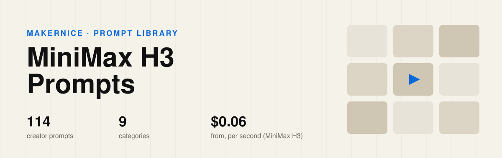

<p align="center"></p>

<h1 align="center">Awesome MiniMax H3 Prompts</h1>

<p align="center"><b>114 MiniMax H3 (Hailuo AI) video prompts, hand-picked from creators on X</b> — not scraped. Every clip was watched and every prompt checked against the creator's own post,<br>each one credited and one click away from a rerun on Makernice with the price shown first.</p>

<p align="center">
<a href="#-browse-by-category"></a>
<a href="#-browse-by-category"></a>

<a href="https://makernice.com/models/minimax-h3/?utm_source=github&utm_medium=prompts-repo&utm_campaign=awesome-minimax-h3-prompts"></a>
<a href="#%EF%B8%8F-license--reuse"></a>
</p>

<p align="center"><b><a href="https://makernice.com/prompts/minimax-h3/?utm_source=github&utm_medium=prompts-repo&utm_campaign=awesome-minimax-h3-prompts">▶ Watch the clips with sound on Makernice</a></b> · <a href="https://github.com/makernice/awesome-seedance-2.5-prompts">Seedance 2.5 prompts</a> · <a href="https://github.com/makernice/awesome-wan-kling-prompts">Wan & Kling prompts</a></p>

## Contents

- [🗂️ Browse by category](#%EF%B8%8F-browse-by-category)
- [⭐ Featured](#-featured)
- [🔥 Most liked](#-most-liked)
- [🎬 MiniMax H3 at a glance](#-minimax-h3-at-a-glance)
- [💡 What these prompts teach](#-what-these-prompts-teach)
- [▶️ Run these prompts](#%EF%B8%8F-run-these-prompts)
- [✅ Why this list](#-why-this-list)
- [📊 Statistics](#-statistics)
- [🤝 How to contribute](#-how-to-contribute)
- [©️ Copyright & takedown notice](#%EF%B8%8F-copyright--takedown-notice)
- [⚖️ License & reuse](#%EF%B8%8F-license--reuse)
- [🙏 Acknowledgements](#-acknowledgements)
- [👤 Maintainer](#-maintainer)

## 🗂️ Browse by category

<table>
<tr><td width="33%" valign="top" align="center"><a href="prompts/fantasy-surreal.md"></a><br><b>🪐 <a href="prompts/fantasy-surreal.md">Fantasy &amp; Surreal</a></b><br><sub>26 prompts</sub></td><td width="33%" valign="top" align="center"><a href="prompts/product-ads.md"></a><br><b>🛍️ <a href="prompts/product-ads.md">Product (UGC &amp; Ads)</a></b><br><sub>18 prompts</sub></td><td width="33%" valign="top" align="center"><a href="prompts/cinematic-drama.md"></a><br><b>🎭 <a href="prompts/cinematic-drama.md">Cinematic &amp; Drama</a></b><br><sub>17 prompts</sub></td></tr>
<tr><td width="33%" valign="top" align="center"><a href="prompts/anime.md"></a><br><b>🌸 <a href="prompts/anime.md">Anime</a></b><br><sub>16 prompts</sub></td><td width="33%" valign="top" align="center"><a href="prompts/fashion-dance.md"></a><br><b>👗 <a href="prompts/fashion-dance.md">Fashion &amp; Dance</a></b><br><sub>12 prompts</sub></td><td width="33%" valign="top" align="center"><a href="prompts/3d-cartoon.md"></a><br><b>🧸 <a href="prompts/3d-cartoon.md">3D &amp; Cartoon</a></b><br><sub>12 prompts</sub></td></tr>
<tr><td width="33%" valign="top" align="center"><a href="prompts/travel-nature.md"></a><br><b>🏔️ <a href="prompts/travel-nature.md">Travel &amp; Nature</a></b><br><sub>6 prompts</sub></td><td width="33%" valign="top" align="center"><a href="prompts/vlog-daily-life.md"></a><br><b>📱 <a href="prompts/vlog-daily-life.md">Vlog &amp; Daily Life</a></b><br><sub>5 prompts</sub></td><td width="33%" valign="top" align="center"><a href="prompts/action.md"></a><br><b>💥 <a href="prompts/action.md">Action &amp; Martial Arts</a></b><br><sub>2 prompts</sub></td></tr>
</table>

## ⭐ Featured

<table>
<tr><td width="33%" valign="top" align="center"><a href="prompts/anime.md#user-content-p-2100932191316557922"></a><br><b><a href="prompts/anime.md#user-content-p-2100932191316557922">Anime Maid Girl Knocks Desktop Icons Off Screen</a></b><br><sub>8 s · 16:9 · <a href="https://x.com/Mayz1169/status/2100932191316557922">@Mayz1169</a></sub></td><td width="33%" valign="top" align="center"><a href="prompts/cinematic-drama.md#user-content-p-2082561712914567207"></a><br><b><a href="prompts/cinematic-drama.md#user-content-p-2082561712914567207">Handheld Concert Documentary of a Young Singer</a></b><br><sub>15 s · 16:9 · <a href="https://x.com/BrentLynch/status/2082561712914567207">@BrentLynch</a></sub></td><td width="33%" valign="top" align="center"><a href="prompts/vlog-daily-life.md#user-content-p-2101007280040784269"></a><br><b><a href="prompts/vlog-daily-life.md#user-content-p-2101007280040784269">Sushi Bistro Counter Single Handheld Take</a></b><br><sub>15 s · 16:9 · <a href="https://x.com/EndFolding79421/status/2101007280040784269">@EndFolding79421</a></sub></td></tr>
<tr><td width="33%" valign="top" align="center"><a href="prompts/3d-cartoon.md#user-content-p-2084552480554446929"></a><br><b><a href="prompts/3d-cartoon.md#user-content-p-2084552480554446929">Kids Counting Video With Cute 3D Characters From 1 to 4</a></b><br><sub>15 s · 16:9 · <a href="https://x.com/Strength04_X/status/2084552480554446929">@Strength04_X</a></sub></td><td width="33%" valign="top" align="center"><a href="prompts/product-ads.md#user-content-p-2084241879097303513"></a><br><b><a href="prompts/product-ads.md#user-content-p-2084241879097303513">Matcha Lifestyle UGC Ad With a Consistent Face</a></b><br><sub>15 s · 16:9 · <a href="https://x.com/SimplyAnnisa/status/2084241879097303513">@SimplyAnnisa</a></sub></td><td width="33%" valign="top" align="center"><a href="prompts/travel-nature.md#user-content-p-2082700637444452380"></a><br><b><a href="prompts/travel-nature.md#user-content-p-2082700637444452380">Cliff-Edge Camera Descent to a Stormy Ocean</a></b><br><sub>15 s · 16:9 · <a href="https://x.com/umesh_ai/status/2082700637444452380">@umesh_ai</a></sub></td></tr>
</table>

## 🔥 Most liked

Likes on the original X post, read on 2026-11-06.

| # | | Prompt | Category | Length | Creator | ♥ on X |
|---|---|---|---|---|---|---|
| 1 |  | [Anime Maid Girl Knocks Desktop Icons Off Screen](prompts/anime.md#user-content-p-2100932191316557922) | Anime | 8 s | [@Mayz1169](https://x.com/Mayz1169/status/2100932191316557922) | 1,802 |
| 2 |  | [Cinematic Character Introduction From a Single Reference](prompts/anime.md#user-content-p-2086412223061135392) | Anime | 15 s | [@aimikoda](https://x.com/aimikoda/status/2086412223061135392) | 1,514 |
| 3 |  | [Ten-Pose High-Fashion Studio Editorial Film](prompts/anime.md#user-content-p-2096295356526956809) | Anime | 15 s | [@aimikoda](https://x.com/aimikoda/status/2096295356526956809) | 1,338 |
| 4 |  | [Maker Rebuilds a Pictured Subject From Scratch](prompts/fantasy-surreal.md#user-content-p-2095141166962311555) | Fantasy & Surreal | 15 s | [@aimikoda](https://x.com/aimikoda/status/2095141166962311555) | 880 |
| 5 |  | [Diner Worker Walks Home at Night](prompts/cinematic-drama.md#user-content-p-2109791105671700721) | Cinematic & Drama | 12 s | [@EndFolding79421](https://x.com/EndFolding79421/status/2109791105671700721) | 721 |
| 6 |  | [Vintage Cartoon Police Officer in a Haunted Hallway](prompts/anime.md#user-content-p-2102140381001617683) | Anime | 6 s | [@thefinnmckenty](https://x.com/thefinnmckenty/status/2102140381001617683) | 670 |
| 7 |  | [Anime Dance Fashion Film on a Lemon-Yellow Backdrop](prompts/anime.md#user-content-p-2097001707683119410) | Anime | 15 s | [@aimikoda](https://x.com/aimikoda/status/2097001707683119410) | 602 |
| 8 |  | [Character Built Through a Digital Assembly Process](prompts/fantasy-surreal.md#user-content-p-2095651474797641955) | Fantasy & Surreal | 15 s | [@aimikoda](https://x.com/aimikoda/status/2095651474797641955) | 556 |
| 9 |  | [Alphabet Letters Morph Into Apple, Ball, Cat and Duck](prompts/3d-cartoon.md#user-content-p-2084227244533411987) | 3D & Cartoon | 15 s | [@umesh_ai](https://x.com/umesh_ai/status/2084227244533411987) | 464 |
| 10 |  | [Office Mockumentary Conference Room Gag](prompts/cinematic-drama.md#user-content-p-2084387316286595436) | Cinematic & Drama | 15 s | [@Arminn_Ai](https://x.com/Arminn_Ai/status/2084387316286595436) | 421 |

## 🎬 MiniMax H3 at a glance

| Model on Makernice (price list v12) | Length per run | Price per second | Modes | Aspect ratios |
|---|---|---|---|---|
| MiniMax H3 | 5–15 s | 480p $0.06 · 768p $0.072 · 2K $0.156 · 4K $0.192 | Text-to-video · Image-to-video · First and last frame · up to 5 reference images | 21:9, 16:9, 4:3, 1:1, 3:4, 9:16 |
| MiniMax H3 Max | 5–15 s | 480p $0.045216 · 768p $0.068544 · 1080p $0.1536 | Text-to-video · Image-to-video · First and last frame · up to 4 reference images | 21:9, 16:9, 4:3, 1:1, 3:4, 9:16 |

Failed, timed-out or canceled-while-queued runs release the hold in full.

## 💡 What these prompts teach

- **Long clips are written in parts.** 46 of the 114 split the clip into numbered shots, scenes or time codes.
- **Name the camera.** 98 of the 114 say how the camera moves or where it sits.
- **Write the sound.** 62 of the 114 describe what you should hear.
- **Length is not quality.** These run from 258 to 24,651 characters.

## ▶️ Run these prompts

Every entry links to Makernice, where you can rerun it by API. Entries that are live on the site open the creator's clip, a shot-by-shot breakdown and a one-click rerun. From code, quote first (free, locked for 12 minutes), then create with the quote:

```bash
curl -s https://api.makernice.com/v1/generations/quote \
  -H "Authorization: Bearer $MAKERNICE_API_KEY" \
  -H "Content-Type: application/json" \
  -d '{"model":"minimax-h3","mode":"t2v","duration":10,"resolution":"2k","aspect_ratio":"16:9","prompt":"..."}'
```

## ✅ Why this list

**Hand-picked, not bulk-scraped.** Many prompt lists are collected by scripts. Every entry here was chosen by a person who watched the clip, from posts that drew strong saves and shares on X.

**Checked against the creator's own post.** Every prompt is copied from the creator's post or their own reply in the same thread, then read against the original. Prompts guessed from the video alone are not accepted.

**One click to rerun, price first.** Every entry opens on Makernice, where you can rerun it by API. The price is quoted before you pay, and failed runs are not charged.

## 📊 Statistics

| Metric | Value |
|---|---|
| Prompts in this repository | 114 |
| Unique creators | 56 |
| Categories | 9 |
| Multi-shot or time-coded prompts | 46 |
| Originals that use reference images | 32 |
| Median prompt length | 2,027 characters |
| Last updated | 2026-11-06 |

## 🤝 How to contribute

Found a MiniMax H3 (Hailuo AI) prompt that belongs here? Open an issue with the link to the creator's post. It goes through the same checks as every other entry: the creator's own text, real engagement and the content rules. This README and every page under `prompts/` are generated from `data/`; please do not edit them by hand.

## ©️ Copyright & takedown notice

This repository carries three kinds of material under three different terms.

**Code** (generator scripts and tooling) is released under the MIT License; see the `LICENSE` file. The MIT License covers the code only.

**Curation** (selection, organization, statistics and the summaries written by us) is licensed under [CC BY 4.0](https://creativecommons.org/licenses/by/4.0/). Reuse it with attribution to *Makernice*.

**Prompts and media** remain the copyright of their original creators. Prompt text, thumbnails and video links are quoted from publicly published posts for reference; every entry links back to its original post. Nothing here grants a license to the underlying prompt or media beyond what the original post allows.

**Takedown process.** If you are a rights holder and want an entry removed or corrected, open a GitHub issue with the entry's link and the original post, or email support@makernice.com. Requests are checked against the original post and handled within 3 business days; the entry is removed from `data/` and disappears from every generated file on the next update. Earlier commits in the Git history may still contain it.

## ⚖️ License & reuse

Code in this repository is open source under the MIT License: use it, modify it, build on it, keep the license notice. Curation is CC BY 4.0; prompts and media stay with their creators. Details above under [Copyright & takedown notice](#%EF%B8%8F-copyright--takedown-notice).

## 🙏 Acknowledgements

- **The creators** credited on every entry, for publishing their prompts in the open.
- [LearnPrompt/awesome-seedance](https://github.com/LearnPrompt/awesome-seedance) — source-checked entries, statistics and the three-term copyright notice.
- [ai-boost/awesome-image-video-prompts](https://github.com/ai-boost/awesome-image-video-prompts) — one data file per entry, folded prompts and category pages generated from data.
- [freestylefly/awesome-gpt-image-2](https://github.com/freestylefly/awesome-gpt-image-2) — category cover cards.

## 👤 Maintainer

Maintained by the Makernice Team · [Makernice](https://makernice.com/?utm_source=github&utm_medium=prompts-repo&utm_campaign=awesome-minimax-h3-prompts) · support@makernice.com
